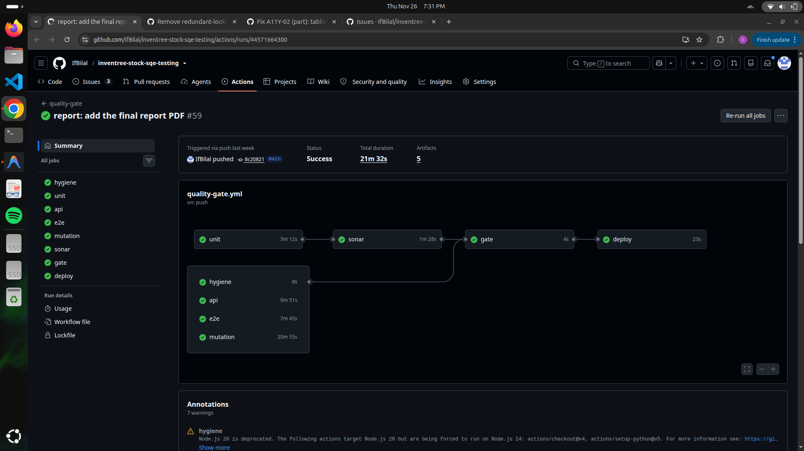
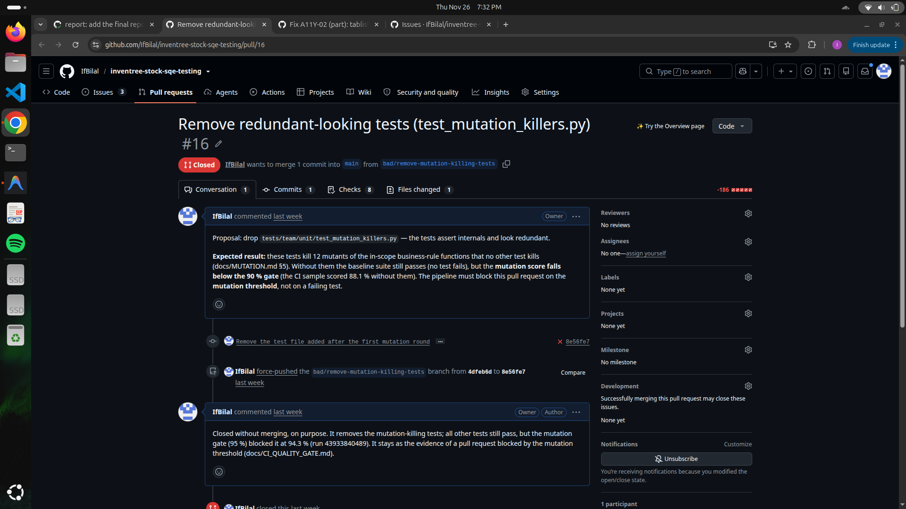
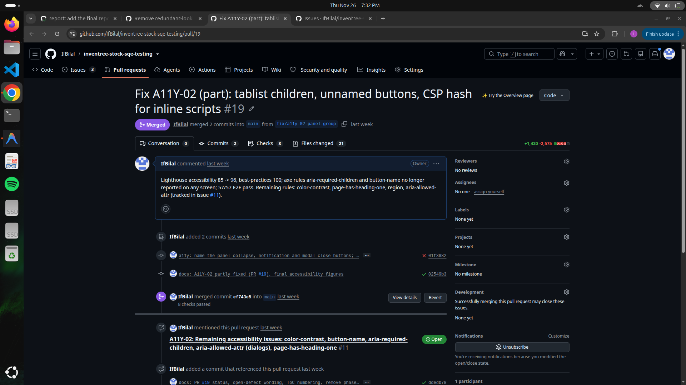

# CI QUALITY GATE (Phase 12) — GitHub Actions on every pull request
Workflow: `.github/workflows/quality-gate.yml` (runs on every **pull request** to `main` and on every push to `main`). Repository: https://github.com/IfBilal/inventree-stock-sqe-testing — Actions: https://github.com/IfBilal/inventree-stock-sqe-testing/actions

## Gates (all required; branch protection on `main` requires every check, `strict` = branch must be up to date)
| Job (required check) | What it runs | Blocks when | Threshold and justification |
|---|---|---|---|
| `hygiene` | `tools/check_no_escape_hatches.py` | any `continue-on-error`, `\|\| true`, `\|\| exit 0`, `set +e`, `if: always()` in the workflows and CI scripts | **0 escape hatches** — the project statement forbids them; the check itself found two `\|\| true` in our own scripts during development and they were removed |
| `unit` | `scripts/coverage_unit.sh` (pytest + coverage.py branch mode) and `tools/scope_coverage.py`; generator tests | any failing test; any in-scope function with an uncovered **statement** or an **unjustified** uncovered branch | **100 % statements and 0 unjustified branches** of the 33 in-scope functions — the statement requires 100 %/100 %; the single unreachable branch is defended in `docs/COVERAGE_JUSTIFICATION.md` and in `JUSTIFIED` of the tool |
| `api` | `scripts/test_api.sh api` — live server, generated EP/BVA (223 cases), business rules, weaknesses, response-schema validation of every response | any failing test, any strict-xfail that unexpectedly passes | all tests pass; defects are pinned by strict xfail so that a fix forces removal of the marker (this is what makes PR #13 "red before, green after") |
| `e2e` | builds the UI, Playwright (30 use-case flows + usability + access matrix) | any failing test, any `test.fail` that unexpectedly passes | all pass |
| `sonar` | SonarQube Community Build started as a service container, scanner with the coverage report, `tools/sonar_gate.py` | bugs ≠ 0, vulnerabilities ≠ 0, security hotspots ≠ 0, code smells > 0, any rating worse than A, **whole-module coverage < 38 %**, duplication > 1 % | baseline measured 0/0/0/0, ratings A, duplication 0.6 %; **coverage 38 %** because the whole-module figure is 40.2 % (the module contains out-of-scope merge/disassemble code); 2 points of tolerance catch a real regression without flapping. In-scope logic is gated separately at 100 % by `unit` *Why a whole-module coverage gate of only 38 %:* the Stock module has 8 390 lines of which only the add/remove business logic is in scope; that logic is gated separately and strictly in the `unit` job (every in-scope statement covered, every uncovered branch justified), so the low whole-module figure does not weaken the gate. |
| `mutation` | isolated runner on a deterministic sample (3 workers, 7 mutants per function, all custom operators kept) and `tools/mutation_gate.py` | adjusted mutation score < **95 %** | final full-set adjusted score 100 % (raw 96.6 %; the first analysis had raw 93.9 %, round 1 was 88.9 %); 95 % separates the improved suite from the pre-improvement one and leaves tolerance for sampling; every non-equivalent survivor counts against the score (`docs/MUTATION.md` §6) |
| `gate` | depends on all of the above (no `if: always()`) | any of the above failed or was skipped | — |
| `deploy` | on push to `main` only, `needs: gate`, environment `release`: builds the release-candidate bundle (docs, evidence, reports) | `gate` not green → **not executed** | deployment is impossible without a green gate |

## Merge and deployment are blocked
- **Merge:** branch protection on `main` (`gh api repos/IfBilal/inventree-stock-sqe-testing/branches/main/protection`): required status checks `hygiene, unit, api, e2e, sonar, mutation, gate`, `strict: true`, no force-push, no deletion.
- **Deployment:** the `deploy` job `needs: [gate]`; a red gate skips it.
- **No escape hatches:** enforced by the `hygiene` job on every run (and a local run in `scripts/`).

## Evidence of the required pull requests
| Requirement | Pull request | Evidence |
|---|---|---|
| **One documented fix that fails before and passes after** | **PR #13** "Fix DEF-01: reject removal larger than the available quantity" (closes issue #1). Commit 1 changes only the tests (defect still present) → pipeline **red**; commit 2 adds the fix → pipeline **green** | run links and results in the table below (generated from the GitHub API) |
| **One pull request the pipeline blocked** | **PR #14** "Allow adjusting stock items that are installed in another item" (branch `bad/relax-adjustability-rule`) — a plausible-looking product request that removes the `belongs_to is None` condition from `StockItem.is_in_stock` and so violates **BR-2 / FR-04** (risk PR-03). Never merged; closed without merging after the pipeline blocked it (kept as evidence) | run 43916978299: **unit, api and mutation fail**, e2e passes (the UI flows do not touch installed items), `sonar`/`gate`/`deploy` skipped → merge blocked |
| **A second blocked PR — mutation score** | **PR #16** "Remove redundant-looking tests (test_mutation_killers.py)" (branch `bad/remove-mutation-killing-tests`) — deletes the 12-mutant killing tests; every other test still passes | run 43933840489: unit, api, e2e, sonar, hygiene **pass**; **`mutation` fails: 94.3 % < 95 % gate** (`evidence/ci/mutation_ci_pr16_blocked_run_43933840489.txt`); closed without merging, kept as evidence. The first run of this PR (run 43927877708) scored 90.4 % and *passed* the then 90 % gate, which is why the threshold was raised to 95 % |
| Further fix PRs | **PR #17** (closes #2, #3, #4) and **PR #18** (closes #6, #7, #8) — each merged only after a green pipeline, never by bypassing the protection (an attempted admin merge of #15 was refused and the branch was updated and re-run instead) | run table below |
| Accessibility fix | **PR #15** "a11y: alt text on item images and a main landmark on the stock item page" (closes issue #10), see `docs/ACCESSIBILITY.md` | passes the full pipeline (run link in the table below) |

## Screenshots
**Green pipeline on `main`** (all 8 jobs: hygiene, unit, api, e2e, mutation, sonar, gate, deploy):

**Blocked pull request #16** (closed without merging; the mutation gate rejected it):

**Fix pull request #19 merged after all checks passed:**

## Run links (GitHub Actions, repository IfBilal/inventree-stock-sqe-testing)
| Run | Pull request / branch | Result | Jobs |
|---|---|---|---|
| 43916868389 | #13 commit 1 (tests only, defect present) | **red** | unit, api, e2e, mutation fail |
| 43918801998 | #13 commit 2 (fix, one related test missed) | **red** | unit, mutation fail (api, e2e cancelled) — the first fix also rejected removal from depleted items |
| 43920009616 | #13 commit 3 (fix corrected) | **green** | all 7 required jobs pass → merged |
| 43916978299 | #14 (BR-2 violation) | **red, blocked** | unit, api, mutation fail |
| 43933840489 | #16 (killing tests removed) | **red, blocked** | mutation 94.3 % < 95 % |
| 43943448899 | #15 accessibility fix (after update from main) | **green** → merged | all 7 required jobs |
| 44326688189 | #17 DEF-02/03/04 validation fixes | **green** → merged | all 7 required jobs (historical run: counts at that time were unit 331, API 250 + 27 xfail, E2E 57; the final counts are unit 342, API 253 + 27 xfail, E2E 57 — `docs/COMPLETION_REPORT.md` §2) |
| 44339141434 | #18 DEF-06, SEC-01, SEC-02 | **green** → merged | all 7 required jobs (E2E passes under the new Content-Security-Policy) |

## CI-produced mutation scores
`evidence/ci/mutation_ci_run_43911640347.txt`: 159 mutants, 140 killed → **88.1 %** (gate then 85 %: passed). `evidence/ci/mutation_ci_run_43920009616.txt`: after the first killing tests, **98.7 % adjusted** (gate 90 %: passed). PR #16 (first run) shows the same sample without the killing tests: 90.4 % raw → 94.3 % adjusted once equivalents were listed. Hence the gate is now 95 %.
