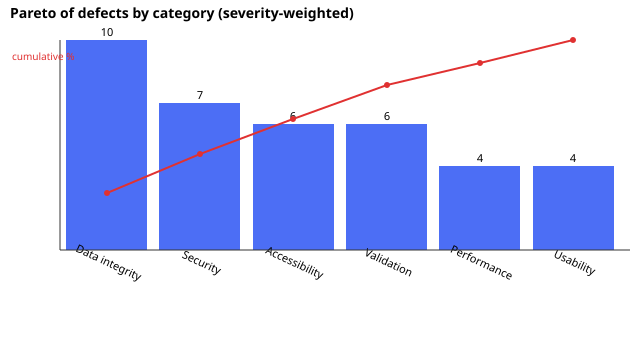

# DEFECT LOG, TRIAGE AND PARETO ANALYSIS (generated by `tools/defects_report.py` from `docs/defects.json`)

Defects live in **GitHub Issues of this repository** (https://github.com/IfBilal/inventree-stock-sqe-testing) — never upstream. Severity: Critical (data loss/corruption, whole-feature outage), High (availability under normal use), Medium, Low. Priority P1 = fix first … P3 = later. Weights for the Pareto: Critical 5, High 4, Medium 3, Low 1.

| ID | Issue | Title | Category | Severity | Priority | Status | Triage decision | Risk | Found in |
|---|---|---|---|---|---|---|---|---|---|
| DEF-01 | [#1](https://github.com/IfBilal/inventree-stock-sqe-testing/issues/1) | Over-removal silently clamped (data loss) | Data integrity | Critical | P1 | Closed (fixed) | accepted | PR-01 | Phase 1/4/6 |
| DEF-02 | [#2](https://github.com/IfBilal/inventree-stock-sqe-testing/issues/2) | Quantity 0 accepted as silent no-op | Validation | Medium | P2 | Closed (fixed) | accepted | PR-04 | Phase 1/6/7 |
| DEF-03 | [#3](https://github.com/IfBilal/inventree-stock-sqe-testing/issues/3) | Resulting quantity overflow: item unreadable, stock list returns 500 | Data integrity | Critical | P1 | Closed (fixed) | accepted | PR-04, PR-01 | Phase 1/6 |
| DEF-04 | [#4](https://github.com/IfBilal/inventree-stock-sqe-testing/issues/4) | Malformed items (null/string/int) -> HTTP 500 | Validation | Medium | P2 | Closed (fixed) | accepted | PR-04 | Phase 6 (generator) |
| DEF-05 | [#5](https://github.com/IfBilal/inventree-stock-sqe-testing/issues/5) | First login after server start silently fails | Usability | Medium | P3 | Open (deferred) | accepted | PR-09 | Phase 7 |
| DEF-06 | [#6](https://github.com/IfBilal/inventree-stock-sqe-testing/issues/6) | Concurrent adjustments fail with HTTP 500 (SQLite lock), ~20% at 5 users | Performance | High | P2 | Closed (fixed) | accepted | PR-08 | Phase 10 |
| SEC-01 | [#7](https://github.com/IfBilal/inventree-stock-sqe-testing/issues/7) | No Content-Security-Policy header | Security | Medium | P3 | Closed (fixed) | accepted | PR-02, PR-10 | Phase 9 |
| SEC-02 | [#8](https://github.com/IfBilal/inventree-stock-sqe-testing/issues/8) | Session cookie without SameSite (default config) | Security | Low | P3 | Closed (fixed) | accepted | PR-02 | Phase 9 |
| SEC-03 | [#9](https://github.com/IfBilal/inventree-stock-sqe-testing/issues/9) | react-router 6.30.6 advisories in the shipped bundle | Security | Medium | P3 | Accepted (risk) | accepted | PR-10 | Phase 9 |
| A11Y-01 | [#10](https://github.com/IfBilal/inventree-stock-sqe-testing/issues/10) | Item page: images without alt, no main landmark | Accessibility | Medium | P2 | Closed (fixed) | accepted | PR-09 | Phase 8 |
| A11Y-02 | [#11](https://github.com/IfBilal/inventree-stock-sqe-testing/issues/11) | Remaining a11y issues (contrast, button names, ARIA) | Accessibility | Medium | P3 | Open (deferred) | accepted | PR-09 | Phase 8 |
| UX-01 | [#12](https://github.com/IfBilal/inventree-stock-sqe-testing/issues/12) | Enter in quantity field does not submit the dialog | Usability | Low | P3 | Open (deferred) | accepted | PR-09 | Phase 7 |

## Lifecycle (status changes over time)
| Defect | When | Status | Note |
|---|---|---|---|
| DEF-01 | 2026-11-16 17:50 | Opened | found in Phase 1 (empirical audit), Critical/P1, triage: accepted |
| DEF-01 | 2026-11-16 21:50 | Fix proposed | PR #13 opened; tests-only commit → pipeline red (run 43916868389) |
| DEF-01 | 2026-11-16 22:30 | Fix pushed | commit 35683ef; pipeline red on a related test (depleted item) → commit 05a49ce |
| DEF-01 | 2026-11-16 23:00 | In verification | pipeline run 43920009616: unit, api, e2e, sonar green |
| DEF-01 | 2026-11-16 23:00 | Verified | pipeline green (run 43920009616), unit/API/E2E tests of the defect pass without xfail |
| DEF-01 | 2026-11-16 23:05 | Closed | PR #13 merged; issue #1 closed |
| DEF-02 | 2026-11-16 | Opened | triage: accepted |
| DEF-02 | 2026-11-18 | Closed | PR #17: StockAdd/StockRemove serializers require a non-zero quantity; tests and E2E flows pass without expected-failure markers; issue #2 closed |
| DEF-03 | 2026-11-16 17:50 | Opened | Phase 1 audit, High/P2 |
| DEF-03 | 2026-11-16 20:15 | Re-triaged | severity High→Critical, P2→P1: one corrupted item breaks the whole stock list (found in Phase 6) |
| DEF-03 | 2026-11-18 | Closed | PR #17: StockAddSerializer.validate rejects totals above 9 999 999 999.99999 (entries of one item summed); the unreadable-item and broken-list failures cannot be produced any more; issue #3 closed |
| DEF-04 | 2026-11-16 | Opened | triage: accepted |
| DEF-04 | 2026-11-18 | Closed | PR #17: malformed items answer HTTP 400 with a validation message; issue #4 closed |
| DEF-05 | 2026-11-16 | Opened | triage: accepted |
| DEF-05 | 2026-11-18 | Open | Medium/P3: first login after a server start fails once; documented workaround in the E2E set-up; not part of the add/remove workflows |
| DEF-06 | 2026-11-16 | Opened | triage: accepted |
| DEF-06 | 2026-11-18 | Closed | PR #18: SQLite IMMEDIATE transactions + 30 s timeout; failures at 5 users 19.5 % -> 0 % (k6, 4 runs); the p95 gap of EC-3 is tracked as risk PR-08, not as this defect; issue #6 closed |
| SEC-01 | 2026-11-16 | Opened | triage: accepted |
| SEC-01 | 2026-11-18 | Closed | PR #18: Content-Security-Policy header; whole Playwright suite passes under it; issue #7 closed |
| SEC-02 | 2026-11-16 | Opened | triage: accepted |
| SEC-02 | 2026-11-18 | Closed | PR #18: SameSite=Lax is the default; issue #8 closed |
| SEC-03 | 2026-11-16 | Opened | triage: accepted |
| SEC-03 | 2026-11-18 | Accepted | no patched react-router 6.x exists (fix = major migration to >= 7.18); exploitation narrowed by CSP/SameSite; re-evaluate with the next upstream release |
| A11Y-01 | 2026-11-16 21:15 | Opened | Phase 8, Medium/P2 |
| A11Y-01 | 2026-11-16 21:20 | Fix proposed | branch fix/a11y-stock-item-page; Lighthouse 78→85 |
| A11Y-01 | 2026-11-17 | Fix revised | first alt="" version introduced axe presentation-role-conflict; alt now uses aria-label (review finding) |
| A11Y-01 | 2026-11-17 | Closed | PR #15 merged after green pipeline; issue #10 closed |
| A11Y-02 | 2026-11-16 | Opened | triage: accepted |
| A11Y-02 | 2026-11-18 | Open | Medium/P3: remaining contrast / button-name / ARIA findings of the UI (need frontend design decisions) |
| UX-01 | 2026-11-16 | Opened | triage: accepted |
| UX-01 | 2026-11-18 | Open | Low/P4: Enter in the quantity field of the stock-adjust dialog does not submit (table-row fields have no form context) |

## Pareto by category
| Category | Defects | Severity-weighted points | Share | Cumulative |
|---|---|---|---|---|
| Data integrity | 2 | 10 | 27 % | 27 % |
| Security | 3 | 7 | 19 % | 46 % |
| Accessibility | 2 | 6 | 16 % | 62 % |
| Validation | 2 | 6 | 16 % | 78 % |
| Performance | 1 | 4 | 11 % | 89 % |
| Usability | 2 | 4 | 11 % | 100 % |

The top three categories (Data integrity, Security, Accessibility) account for 62 % of the severity-weighted defect load; **Data integrity** alone (DEF-01, DEF-03: 2 defects, both Critical) is the largest single category, which matches the risk register (PR-01 is the only Critical risk). See `pareto_defects.svg`.

