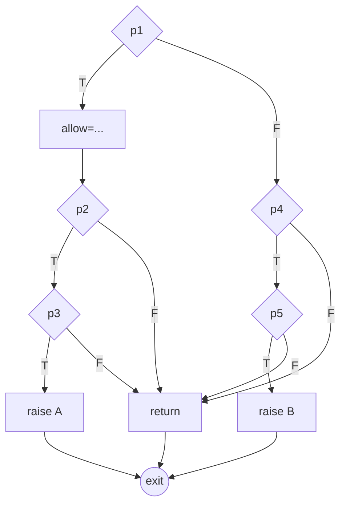

# STATIC ANALYSIS — SonarQube metrics and hand-calculated cyclomatic complexity (Phase 3)

Tool: SonarQube Community Build **26.10.0.133078**, Python analyzer plugin 5.32, scanner 6.2.1.4610, JDK 21.0.13 (Temurin). Server run locally from the zip distribution (no Docker daemon available on the machine); data directory on tmpfs because Elasticsearch's 90 % disk watermark blocked start on the nearly full disk — metrics are exported to `evidence/sonar/` immediately after each scan.
Scope (`sonar-project.properties`): `upstream/src/backend/InvenTree/stock` (excluding migrations, fixtures, locale, tests); upstream tests and `tests/team` are declared as **tests**, so they are not counted as production code.
Run: `scripts/sonar_scan.sh` (re-runs the scan and re-exports metrics). Raw data: `evidence/sonar/project_measures.json`.
Analysis warnings: exactly one — `No report was found for sonar.python.coverage.reportPaths` (no coverage report exists before Phase 4); no analyzer errors. Dashboard screenshot: `evidence/sonar/dashboard.png`.
Analyzer validation: a throw-away file with a hard-coded password and `a == a` produced 1 vulnerability and 1 bug, proving the analyzer flags problems, so the **0 issues** below is a genuine result, not a tool failure (InvenTree enforces ruff in its CI).

## 1. Metrics (baseline, before our tests — coverage is 0 because no coverage report was supplied yet)
| Metric | Value | What it shows / how we read it |
|---|---|---|
| Lines / Lines of code (ncloc) | 8 390 / 5 114 | Size of the analysed module (11 files, 223 functions, 117 classes). Basis for density measures; ncloc excludes comments and blanks. |
| Cyclomatic complexity | 773 | Sum of independent paths over the module. Mean ≈ 3.5 per function (773/223): mostly simple functions. Higher values mean more tests are needed to cover branches. |
| Cognitive complexity | 803 | How hard the code is to *understand* (nesting weighted). Close to cyclomatic → little deep nesting. |
| Duplicated lines density | 0.6 % (2 blocks, 1 file) | Copy-paste risk: very low; one file contains 2 duplicate blocks (change one, forget the other). |
| Code smells | 0 | Maintainability issues (naming, dead code, complexity rules). None raised by the 232 active Python rules. |
| Bugs | 0 | Likely faults (e.g. identical operands). None. |
| Vulnerabilities / Security hotspots | 0 / 0 | Security-sensitive code (hard-coded credentials, weak crypto…). None flagged — absence of static findings does **not** mean the module is secure (see our dynamic checks in Phase 9). |
| Technical debt (sqale_index) / debt ratio | 0 min / 0.0 % | Estimated remediation time of all smells ÷ development cost. 0 because there are no smells. |
| Ratings: reliability / security / maintainability (sqale) | A / A / A (value 1.0) | Derived from bugs, vulnerabilities and debt ratio. |
| Coverage / line / branch | 0 % / 0 % / 0 % | Share of code run by tests. 0 because **no coverage report** has been imported yet; becomes meaningful after Phase 4 (`evidence/coverage/coverage.xml`). |
| Quality gate | OK | Sonar way gate evaluates *new* code; on first analysis it passes. |
Important limits: a clean static report does not contradict the dynamic defects we found (DEF-01 over-removal clamping, DEF-02 zero accepted, DEF-03 overflow → 500): they are *behavioural* defects against our requirements that static rules cannot know. This is itself a finding for the test completion report.

## 1a. Where the complexity and duplication are (per file, `evidence/sonar/per_file_metrics.txt`)
| File | ncloc | Cyclomatic | Cognitive | Duplicated lines |
|---|---|---|---|---|
| `models.py` | 2 172 | 479 (**62 %** of 773) | 505 | 0 |
| `serializers.py` | 1 567 | 157 | 174 | **50** |
| `api.py` | 1 047 | 119 | 101 | 0 |
| `generators.py` | 66 | 12 | 22 | 0 |
| others (filters, admin, settings, events, status codes) | 255 | 6 | 1 | 0 |
Most complex functions (radon, `evidence/sonar/radon_top_complexity.txt`): `StockItem.clean` 29, `disassemble` 26, `merge_stock_items` 25, `stocktake` 18, `StockList.create` 30 / class `StockList` 31. The in-scope adjustment functions are small by comparison (`take_stock`, `add_stock`, `validate_pk` all ≤ 12), so complexity risk in this module sits **outside** our workflows (merge/disassemble), which are out of scope.
**Duplication:** the only duplicated blocks (2 × 25 lines, `serializers.py` lines 2017–2041 and 2051–2075, `evidence/sonar/duplications.txt`) are **`StockAddSerializer.save` and `StockRemoveSerializer.save`** — i.e. precisely our two workflows. Risk: a fix to one (for example the over-removal rule, DEF-01) can be forgotten in the other; the tests therefore exercise both with the same assertions.

## 1b. Link to the risk register and rating definitions
- Ratings: reliability A = 0 bugs; security A = 0 vulnerabilities; maintainability (sqale) A = technical-debt ratio ≤ 5 %; security-review A = ≥ 80 % hotspots reviewed (none exist).
- **PR-03:** V(G) of `validate_pk` = 6 ⇒ ≥ 6 basis-path tests; the 5-condition decision needs MCC/MC/DC (Phase 4).
- **PR-01 / EC-1:** coverage is **0 %** at baseline; it is the starting point for the 100 %/100 % target.
- **PR-01, PR-04:** a clean static report (0 bugs/smells) does **not** mitigate them — they are behavioural defects against requirements (observed dynamically), not rule violations.
- **PR-02, PR-10:** "0 vulnerabilities / 0 hotspots" in Sonar covers only the Stock module source; dependency and access-control risks need the Phase 9 activities.

## 2. Hand-calculated cyclomatic complexity — `StockAdjustmentItemSerializer.validate_pk`
Source: `upstream/src/backend/InvenTree/stock/serializers.py` lines 1835–1850 (implements BR-2). Verbatim extract: `evidence/sonar/function_extract/validate_pk_extract.py`.

```
def validate_pk(self, stock_item):                       # entry
    if self.require_in_stock == True:                    # p1
        allow = get_global_setting(...)                  # S2
        if not allow and not stock_item.is_in_stock(...):# p2 (not allow) AND p3 (not is_in_stock)
            raise ValidationError(...)                   # S5
    elif self.require_in_stock == False:                 # p4
        if stock_item.is_in_stock():                     # p5
            raise ValidationError(...)                   # S8
    return stock_item                                    # S9
```
### Control-flow graph (compound condition expanded into atomic predicates, short-circuit)
| Node | Content |
|---|---|
| N1 | p1: `require_in_stock == True` |
| N2 | `allow = get_global_setting(...)` |
| N3 | p2: `not allow` |
| N4 | p3: `not stock_item.is_in_stock(...)` |
| N5 | `raise ValidationError('not in stock')` |
| N6 | p4: `require_in_stock == False` |
| N7 | p5: `stock_item.is_in_stock()` |
| N8 | `raise ValidationError('already in stock')` |
| N9 | `return stock_item` |
| N10 | exit |
| Edge | | Edge | |
|---|---|---|---|
| e1 | N1→N2 (p1 true) | e8 | N6→N7 (p4 true) |
| e2 | N1→N6 (p1 false) | e9 | N6→N9 (p4 false) |
| e3 | N2→N3 | e10 | N7→N8 (p5 true) |
| e4 | N3→N4 (p2 true) | e11 | N7→N9 (p5 false) |
| e5 | N3→N9 (p2 false, short-circuit) | e12 | N8→N10 |
| e6 | N4→N5 (p3 true) | e13 | N9→N10 |
| e7 | N4→N9 (p3 false) | e14 | N5→N10 |


**Calculation:** E = 14, N = 10, P = 1 → **V(G) = E − N + 2P = 14 − 10 + 2 = 6**.
Cross-check by predicates: 5 atomic predicates (p1…p5) + 1 = **6**. Cross-check by regions of the planar graph: 6 regions (5 bounded + 1 outer).
Independent basis paths (6): (1) p1F,p4F → return; (2) p1F,p4T,p5F → return; (3) p1F,p4T,p5T → raise B; (4) p1T,p2F → return; (5) p1T,p2T,p3F → return; (6) p1T,p2T,p3T → raise A. Each is exercised by a unit test in Phase 4.

## 3. Comparison with tools
| Source | Complexity of `validate_pk` |
|---|---|
| Hand calculation (CFG, E−N+2) | **6** |
| radon (`radon cc`, `evidence/sonar/radon_validate_pk.json`) | 6 |
| SonarQube, extract analysed as its own file (`evidence/sonar/validate_pk_extract_measures.json`) | **5** (cognitive 7) |
**Why Sonar is 1 lower.** A controlled experiment (`evidence/sonar/complexity_experiment/`, results `complexity_experiment.txt`) shows SonarQube's Python *cyclomatic* complexity counts: +1 per function, +1 per `if`, +1 per `and`/`or`, but **does not add +1 for an `elif` branch** (`if/elif` file = 2, `if` file = 2; `if x and y` file = 3). `validate_pk` has one `elif` (p4), so Sonar reports 5 where the graph-theoretic V(G) (which counts every decision) is 6. Its *cognitive* complexity does count the `elif`. (Limitation: the experiment has one `elif` per file; the rule "elif adds 0" is consistent across all 6 files and with the 5 vs 6 difference observed.) We therefore use 6 for test design (6 basis paths ⇒ at least 6 test cases for full branch/path-basis coverage) and note Sonar's metric under-counts `elif`.
