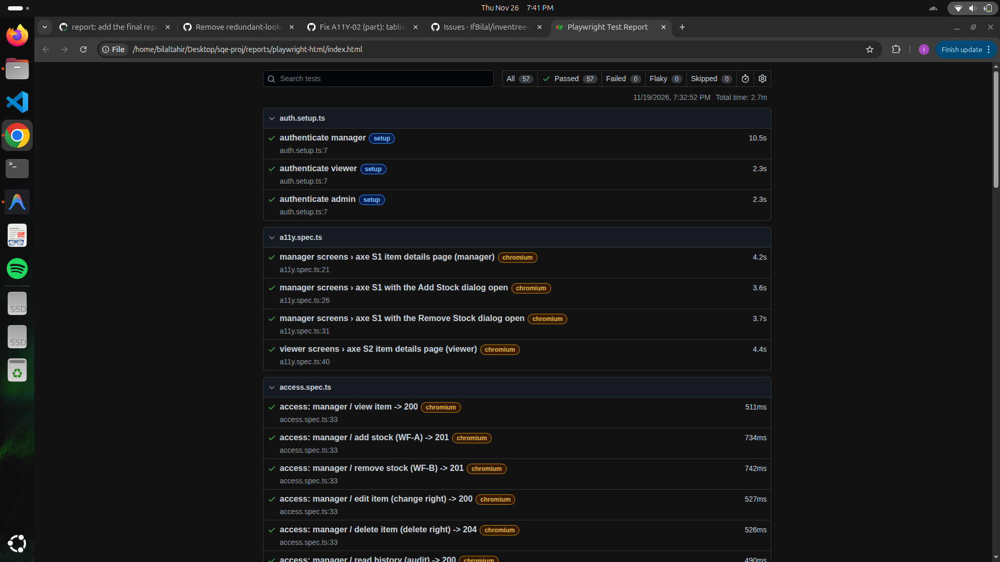

# USABILITY AND ACCESSIBILITY — mapping to project statement §3 (Phase 8)
Automated only (no participants). Scripts: `tests/team/e2e/*.spec.ts` (Playwright), `tests/team/a11y/lighthouse_run.mjs`, `tests/team/e2e/a11y.spec.ts`. Reports: `reports/playwright-report.json`, `evidence/a11y/` (raw Lighthouse and axe JSON, before and after), `docs/ACCESSIBILITY.md` (merged findings).

| §3 requirement | Where it is satisfied |
|---|---|
| Two automated browser tests, one per workflow: open the task screen, complete the task with test data, assert the confirmation | **Designated tests — WF-A Add stock: `UC06-MAIN`** (task screen → completes the task after a correction → "Success — Stock added" toast, dialog closed, `Quantity: 11.12345` badge, API read-back; this is also the test with the rejected-value step below). **WF-B Remove stock: `UC02-MAIN`** (opens the task screen, removes 4 from 10, asserts "Success — Stock removed", `Quantity: 6`, history entry with the balances). Further completion tests: `UC01-MAIN`, `UC03-MAIN`. The keyboard test `UC06-AF2` belongs to WF-A as well; WF-B is covered by the completion test above plus the over-removal rejection flows (`UC02-EF1`, `UC06-AF1`: error names the available quantity, correction, success) |
| In one test: submit a value the business rule rejects, verify the error explains what to correct, correct it, verify success | `UC06-MAIN`: Add 1.123456 → dialog stays open with **"Ensure that there are no more than 5 decimal places."** (names the rule and the limit) → value corrected to 1.12345 in the same dialog → success, quantity and history read back. (The WF-B version, `UC06-AF1` — Remove 15 → "Cannot remove more than the available quantity (10)" → 10 → success — passes since the DEF-01 fix in PR #13.) |
| In one test: keyboard navigation — focus reaches the required fields and submit button in the expected order; the keyboard can submit | `UC06-AF2`: focus starts at `number-field-quantity` → `text-field-notes` → … → `Submit` (order asserted by index); the keyboard submits by Tab to **Submit** + Enter. **UX-01 (observation):** Enter inside the quantity field does *not* submit the dialog (asserted as documented behaviour) |
| Lighthouse (accessibility, best practices, SEO) on each use case's key screen (logged in) + full axe-core scan; an issue found by both tools counted once; each issue: element, user impact, proposed fix | `docs/ACCESSIBILITY.md` (generated by `tools/a11y_report.py`, deduplicated by rule id). Screens: S1 item details as manager (UC-01…UC-04, UC-06), S2 item details as viewer (UC-05), plus axe on the open Add/Remove dialogs |
| Fix one screen (in the MIS or own page), rerun both tools, compare before/after | **Fixed in the MIS** (pull request from branch `fix/a11y-stock-item-page`, two source changes in `upstream/src/frontend`; see PR link in `docs/COMPLETION_REPORT.md` §6): `alt` on the item images (`ApiImage.tsx`) and the routed content rendered inside `<main>` (`Layout.tsx`). Lighthouse accessibility **78 → 85** with PR #15 and **→ 96** with the follow-up PR #19 (tab list, unnamed buttons), SEO 75 → 83 (S1 and S2); `image-alt` and `landmark-one-main` resolved on the item details page; axe distinct issues on S1: 9 → 7 (deduplicated with Lighthouse) |
| Submit scripts, Playwright report, Lighthouse and axe reports (before and after) | `tests/team/...`, `evidence/phase7/playwright_report_e2e.json`, `evidence/a11y/*_before.json`, `*_after.json` |

## Playwright report
HTML report of the full browser suite (57 tests: use cases UC01-UC06, usability and keyboard checks, accessibility scans, access matrix); all 57 passed, none failed or flaky:

## Key usability observations
- The dialog's validation messages are specific and actionable (decimals, digits before the point, "valid number"), but the two business-rule defects were **silent** on the baseline: adding 0 and removing more than available both showed "Success" (DEF-02, DEF-01); both are rejected with a message since PR #17 and PR #13, and the E2E flows UC01-EF1, UC02-EF2, UC06-EF1 assert the message.
- The UI protects against one API weakness: an out-of-stock item shows "No entries available" in the Remove dialog (UC03-EF1) while the API would accept the call as a silent no-op.
- DEF-05: the first login after a server start silently fails (Issue #5).
- UX-01: Enter in the quantity field does not submit.
